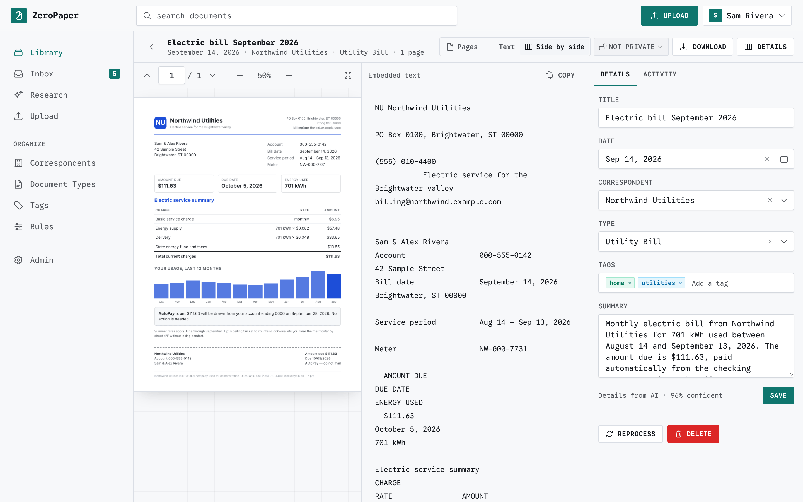

# ZeroPaper

ZeroPaper is a self-hosted document archive built with Ruby on Rails. It turns scans, PDFs, photos, Word files and spreadsheets into a searchable library.

<picture>
  <source srcset="docs/screenshots/document-dark.png" media="(prefers-color-scheme: dark)">
  
</picture>

- **AI providers** through RubyLLM: OpenAI, Anthropic, Google Gemini, Mistral, OpenRouter, DeepSeek, xAI, Ollama or any OpenAI-compatible API. Each task (OCR, document details, Research) can use its own provider and model, and AI can be turned off entirely.
- **OCR** reads scans and photos with a vision model or Mistral Document OCR, with Tesseract or Docling on your machine as the fallback and for private documents. Scans also get a searchable PDF, so text in the viewer can be selected and found.
- **AI metadata** proposes a title, date, correspondent, document type, tags and a summary for each document. You can edit every field, and choose whether AI may create new types and tags or only pick existing ones.
- **Document viewer** shows the PDF, the extracted text, or both side by side, with the text following the page you are on.
- **Hybrid search** combines Postgres full-text search with embeddings computed on your own machine. Dates, correspondents, document types and `#tags` written in a search fill in the filters, all worked out locally. The library filters by several types or tags at once.
- **Research** answers questions across many documents. It shows its progress as it works, cites the documents it used, and saves conversations so you can continue them later.
- **Page cleanup** turns pages that were scanned upside down or sideways upright, and blank page detection finds empty sheets and pages that only show print bleeding through from the other side. It leaves them out of OCR and offers to remove them.
- **Private documents** never leave your machine.
- **Review inbox** collects documents with low-confidence details, possible duplicates, blank pages or processing errors, each with its own fix. Duplicates are found by shared text and can be compared side by side.
- **Rules** file documents automatically: when the text, filename or source matches, set the correspondent and type, add tags, or mark the document private. Correspondents, types and tags also match documents that mention their name; this is on by default and can be turned off for generic names.
- **Tidy up** correspondents, types and tags: ZeroPaper suggests similar names (plurals, spelling, meaning) and merges them, moving their documents and rules.
- **Import** from uploads (files or whole folders, with progress) and a watched folder.
- **Back up and restore** the whole library as one encrypted file, on demand or on a schedule to a folder such as a NAS share.
- **Sign in** with a password or a passkey. An admin adds other users. Each user picks a light, dark or system theme.

## Private documents

A private document is processed only on your machine:

- Its file, text, filename and details are never sent to a hosted AI provider. Every outbound AI request goes through one check that refuses private documents.
- OCR runs locally with Tesseract or Docling. Docling is used only while its host resolves to a loopback or private address, checked again for each document; otherwise every document, not just private ones, is read with Tesseract. Details come from Rules and from matching correspondent, type and tag names in the text, and dates are found in the text.
- Research searches private documents locally but never sends them to the model. When private documents match a question, the answer lists them as links.

There are three ways to mark a document private:

1. Tick **Private** when uploading.
2. Put the file in the `private/` folder inside the ingest folder.
3. Add a rule with **Mark private** that matches the filename, source or document text. Text conditions are checked against locally read text before anything is sent out. To keep everything from one correspondent private, make a rule whose text condition is that correspondent's name; the correspondent's page links to a rule started that way.

Limits:

- The full-text index (individual words) and the embeddings of private documents are stored unencrypted in Postgres, because search needs them. Someone with access to the database can learn which words a private document contains, but not its full text.
- Marking a document private after it was processed normally stops any processing in progress and reprocesses it locally. Details the hosted provider already returned are kept, and nothing more is sent. What was already sent to the provider cannot be recalled.
- Private documents' files are stored unencrypted, like every other document's, so anyone who can read the storage folder can open them. Keep that folder on an encrypted disk or share if this matters. Every document's text, summary and search passages are encrypted in the database.
- Encryption keys are derived from `SECRET_KEY_BASE`. Losing it makes document text unreadable.

## Quick start

You need Docker with Compose.

```sh
git clone <this repository> zeropaper
cd zeropaper
cp .env.example .env
# Set SECRET_KEY_BASE (openssl rand -hex 64) and POSTGRES_PASSWORD in .env
mkdir -p ingest/private backups
docker compose pull
docker compose up -d
```

`docker compose pull` downloads the published image (amd64 and arm64). To build from your checkout instead, run `docker compose up -d --build`.

Open http://localhost:3000. The first person to open a fresh install becomes the admin, so finish setup right after deploying, before anyone else can reach it. The setup wizard creates the admin account, then asks whether to use AI, which provider and models to use, and how to read scans. Everything it asks can be changed later under **Admin**.

The stack has three containers:

| Service | Image | Purpose |
| --- | --- | --- |
| `app` | built from this repository | Web app and background jobs |
| `db` | `pgvector/pgvector:pg18` | Postgres with the pgvector extension |
| `docling` | `quay.io/docling-project/docling-serve-cpu` | Local layout-aware OCR (about 4 GB) |

When the job worker starts, it downloads the embedding model (about 400 MB, at a pinned revision) from Hugging Face into `MODELS_DIR` on the storage volume, unless it is already there. With AI turned off, this is the only outbound request ZeroPaper makes, and it sends nothing about your documents. Each file is checked against its pinned SHA-256, and a damaged file is fetched again. Processing never downloads it: a document that reaches indexing before the download finishes is searchable by keyword right away and gets its meaning index once the download completes, without being read again. After that, embeddings are computed without any network access.

To run fully offline, seed the volume ahead of time: run `bin/rails embedder:prefetch` on a machine with network access and copy `MODELS_DIR` into the volume, or run it once in the container before you cut it off.

Upgrading from a version that did not pin the model downloads it again on the first boot, into a folder named after the revision, and then removes the old copy. For an offline install, run `bin/rails embedder:prefetch` again with the new version and copy the new `MODELS_DIR/Snowflake/snowflake-arctic-embed-m-v1.5/<revision>` folder into the volume.

## Configuration

Settings that take effect at runtime (AI providers and keys, models, OCR, page cleanup, review options, whether to watch the ingest folder) are under **Admin › Settings**; the backup schedule is under **Admin › Backups**. The environment sets the rest:

| Variable | Purpose |
| --- | --- |
| `SECRET_KEY_BASE` | Required. Signs sessions and derives the encryption keys. |
| `POSTGRES_PASSWORD` | Required. Password for the bundled database. |
| `TZ` | Time zone. Defaults to `UTC`. |
| `DOCLING_URL` | Where Docling runs. Set by Compose; when present, Docling is the default local engine. A URL that resolves to a public address is ignored; one whose host does not resolve yet is kept, and documents are read with Tesseract until it resolves to a loopback or private address. |
| `PROCESSING_THREADS` | How many documents are processed at once. Defaults to `6`. Each scan uses up to 2 cores for Tesseract, so about half your cores is a good ceiling. |
| `INGEST_DIR` | The ingest folder. Defaults to `/rails/storage/ingest`; with Docker, mount that path instead of changing it. |
| `BACKUP_DIR` | The backup folder. Defaults to `/rails/storage/backups`; with Docker, mount that path instead of changing it. |
| `PORT` | Host port for the app. Defaults to `3000`. |
| `APP_HOST` | Host name the app is served under. When set, other hosts are refused. |
| `APP_URL` | The address people open, such as `http://nas.local:3000`, used for links in emails and printed reset links. Set it when the app is reached on a port other than 80 or 443. Without it links use the first `APP_HOST`, and without either email is off. |
| `ASSUME_SSL` | `true` when a reverse proxy terminates TLS. |
| `FORCE_SSL` | `true` to redirect to HTTPS and use secure cookies. Required on any host reachable from the internet. |
| `MAX_UPLOAD_MB` | Largest file an upload or the ingest folder accepts. Defaults to `250`. Word and Excel files, older exports and backups made with another key may unzip to four times this for each file. |
| `MAX_BACKUP_GB` | Largest backup ZeroPaper makes, accepts as an upload or restores, both as the file and as everything it unzips to. Defaults to `500`. |
| `MAIL_FROM` | Sender address for email, such as `ZeroPaper <paper@example.com>`. Without it email is off: no password reset emails and no notice when a passkey is added. Mail goes to the SMTP server in `config/environments/production.rb`, which is `localhost:25` unless you change it. |

Passkeys need the app to be reached over HTTPS (or on `localhost`) under a stable host name. Adding one asks for the current password, and when outgoing mail is set up the owner gets an email about it. Changing or resetting a password removes the account's passkeys, since one added by whoever knew the old password would otherwise still sign in.

When email is off, the Forgot Password page says so instead of sending a link. An admin can make a reset link on the server:

```sh
docker compose exec app bin/rails users:reset_password EMAIL=someone@example.com
```

With Kamal, run `bin/kamal app exec "bin/rails users:reset_password EMAIL=someone@example.com"`. The task prints a link that works once and expires after 15 minutes, like an emailed one, and changes nothing by itself. It prints the full link when `APP_URL` or `APP_HOST` is set and otherwise the path to open on the app's address. Choosing the new password signs the account out everywhere and removes its passkeys.

A reset link, emailed or printed, is valid for 15 minutes. Its token is part of the path, so it appears in the request log (the `Started GET "/passwords/.../edit"` line) until it is used or expires.

ZeroPaper reads and searches English only for now.

### OCR

When AI is on and an OCR model is chosen, scans are read by that model. The local engine reads private documents, takes over when the AI read fails, and reads everything when AI is off.

| Engine | Runs | Notes |
| --- | --- | --- |
| Vision model | The provider you choose for the OCR task | Good quality on handwriting and photos. |
| Mistral Document OCR | Mistral | Choose `mistral-ocr-latest` as the OCR model. Strong on tables. |
| Tesseract (ocrmypdf) | Locally, in the app container | Always available. Also produces the searchable PDF shown in the viewer. |
| Docling | Locally, in the `docling` container | Better with tables and complex layouts. Slower on CPU. |

Text that is already in the file (PDFs with a text layer, Word, spreadsheets, plain text) is read directly without OCR. Pages turned sideways or upside down are put upright first, and blank pages are skipped; both can be switched off under Page Cleanup.

### Ingest folder

Files placed in `./ingest` are imported and then removed from the folder. A scanner can save straight into the folder: PDFs, images, Word and Excel files are imported about a second after they are completely written, however long the scan takes. TIFF and text files have no way to tell when they are finished, so they are imported once they have not changed for 10 seconds. A file that is still incomplete after 10 minutes is moved to `.unsupported/`. Files in `./ingest/private` are imported as private. Duplicates of documents already in the library are removed without importing. Watching can be switched off under Settings › Ingest Folder. To use another folder, such as a scanner's network share, change the left side of the `./ingest` mount in `docker-compose.yml`. Symlinks, and files in symlinked folders, are skipped and left where they are. Files larger than `MAX_UPLOAD_MB` are moved to `.unsupported/`; if `.unsupported`, or a folder inside it, is a symlink, they are left where they are instead.

Filenames can say what a document is about, so the log names ingest files by a 12-character id instead of their path. To see which file an id stands for, list the ids of the files still in the folder:

```sh
docker compose exec app bin/rails runner 'Dir.glob("**/*", File::FNM_DOTMATCH, base: Setting.instance.ingest_path).each { |path| puts "#{Ingest::Folder.log_id(path)}  #{path}" }'
```

The ids are keyed with `SECRET_KEY_BASE`, so they cannot be matched against guessed filenames, and they change if it does.

### Deploying with Kamal

`config/deploy.yml.example` deploys the app and Postgres (pgvector) to one server with [Kamal](https://kamal-deploy.org), using a registry that Kamal runs on the server. Copy it to `config/deploy.yml` and fill in your server and host name, then copy `.kamal/secrets.example` to `.kamal/secrets`. Both copies are gitignored.

```sh
bin/kamal setup    # first time: proxy, Postgres and the app
bin/kamal deploy   # later deploys
```

Docling is a commented-out accessory in the example; Tesseract is built in.

The example sets `ssl: false`, which is only safe on a LAN or a Tailscale network. On a host reachable from the internet, set `ssl: true` (or terminate TLS in front of the proxy) and set `FORCE_SSL` and `ASSUME_SSL` to `true`, or passwords, session cookies and documents travel unencrypted. Open the app right after the first deploy: the first visitor to a fresh install becomes the admin.

## Backups

**Admin › Backups** writes the library to `./backups` as one `.zpbackup` file per backup: every document's file, text, details and thumbnail, plus correspondents, types, tags and rules, private documents included. Back up now, or turn on the schedule to back up every day or week. The schedule keeps the newest backup from each of the last few days, weeks, months and years (7, 4, 12 and 2 by default) and removes the rest. Each backup in the list can be restored, downloaded or deleted, and a backup or an export from an older ZeroPaper can be uploaded. Restoring checks the whole backup first and skips documents that are already in the library.

Backups are encrypted (AES-256-GCM) with a backup key that ZeroPaper creates. **Download the key from Admin › Backups and keep it apart from the backups.** A backup and its key restore into a new install without the old database or `SECRET_KEY_BASE`; without the key, nobody can read the backup, including you. Restoring a backup made with another key asks for that key.

To keep backups on a NAS, mount the share on the host and point the `./backups` mount at it in `docker-compose.yml`:

```yaml
    volumes:
      - /mnt/nas/zeropaper:/rails/storage/backups
```

The container runs as uid 1000, so that user needs write access to the share.

Backups hold the library but not users, AI providers or settings. To move a whole server, copy these three together:

1. The `.env` file, especially `SECRET_KEY_BASE`.
2. The `storage` volume, which holds the files. To keep document files on a NAS instead, mount the share at `/rails/storage/files`.
3. The `postgres` volume, or a dump made with `docker compose exec db pg_dump -U zeropaper zeropaper_production`.

## Development

Requirements:

- [mise](https://mise.jdx.dev) for Ruby (the version is in `.ruby-version`, currently 4.0.9)
- Postgres with the pgvector extension
- The PDF and OCR tools

On macOS:

```sh
brew install postgresql@18 pgvector poppler qpdf tesseract ocrmypdf vips
mise install
bin/setup
bin/dev
```

`bin/dev` runs the web server, the Tailwind watcher and the job workers. Open http://localhost:3000. Restart it after changing `config/queue.yml` or `PROCESSING_THREADS`.

To use Docling during development, run the container and set `DOCLING_URL`:

```sh
docker run -d -p 5001:5001 quay.io/docling-project/docling-serve-cpu:v1.37.0
DOCLING_URL=http://localhost:5001 bin/dev
```

Run the tests with:

```sh
bin/rails test
```

### Demo library and screenshots

`script/demo/reset` builds a fictional library (bills, statements, letters, scanned PDFs and receipt photos made from HTML) in a separate `zeropaper_demo` database, running each document through the pipeline with AI off and Tesseract. It needs Node with Playwright, ImageMagick and poppler. Its files land in `storage/files` next to your development files. Then serve it and take the screenshots in `docs/screenshots`:

```sh
script/demo/reset
DATABASE_URL=postgres:///zeropaper_demo bin/rails server -p 3999
node script/demo/screenshots.js   # in another terminal
```

Sign in to the demo as `sam@example.com` with the password `zeropaper-demo`.

### Project website

The website is static HTML in `docs/`. Its stylesheet is built from the app's own Tailwind theme (`docs/assets/site.tailwind.css` imports `app/assets/tailwind/application.css`) into `docs/assets/site.css`, which is committed. Rebuild it after changing `app/assets/tailwind/application.css` or the site's HTML or JavaScript, then preview the site:

```sh
bin/rails site:css
python3 -m http.server -d docs   # http://localhost:8000
```

GitHub Pages serves it with **Deploy from a branch**, branch `master`, folder `/docs`.

### Worktrees

A git worktree gets its own databases, named after its folder, so worktrees never share data with each other or the main checkout. `bin/dev` sets a new worktree up on its first run: it links `tmp/local_secret.txt` and `storage/models` from the main checkout, copies the stored files, copies the main checkout's development database and runs this branch's migrations. Each worktree is served on its own port at `http://<folder>.localhost`, so its session cookie stays separate. `bin/dev` prints the address when it starts.

```sh
bin/worktree reset   # copy the main checkout's database and files again
bin/worktree drop    # drop this worktree's databases before removing it
```
